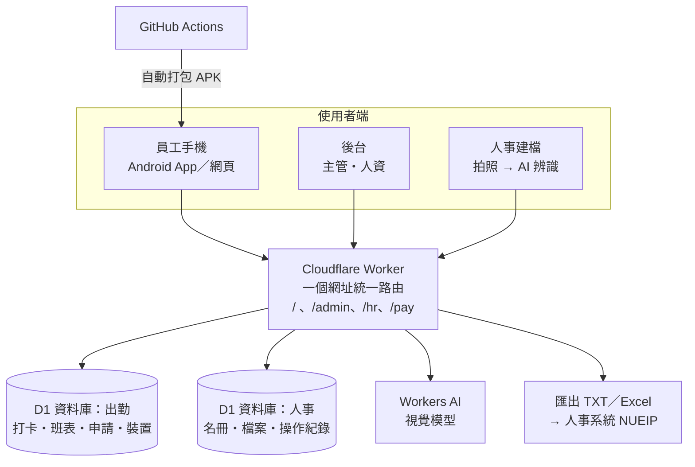
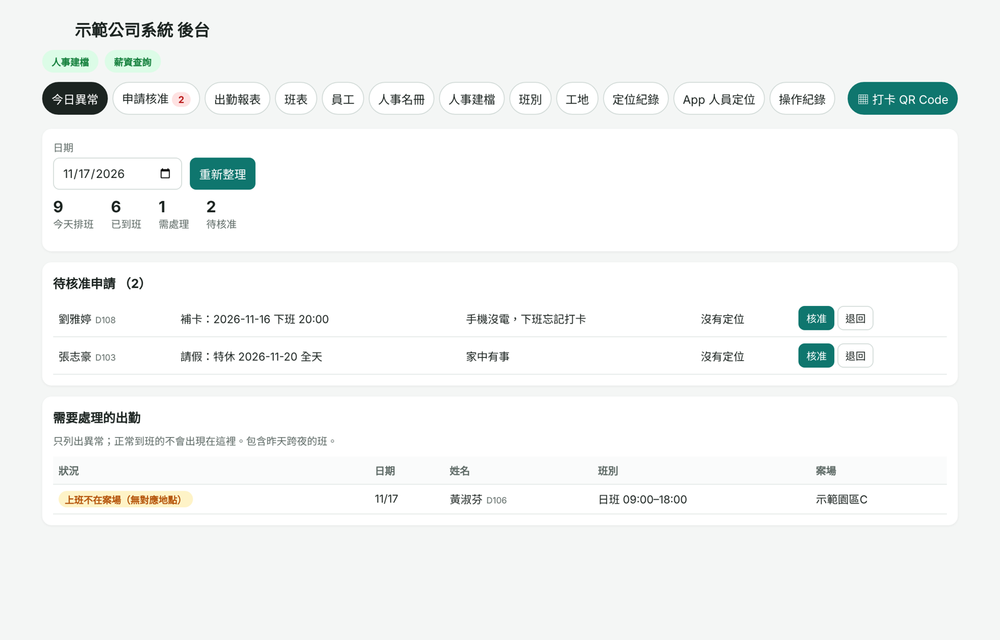
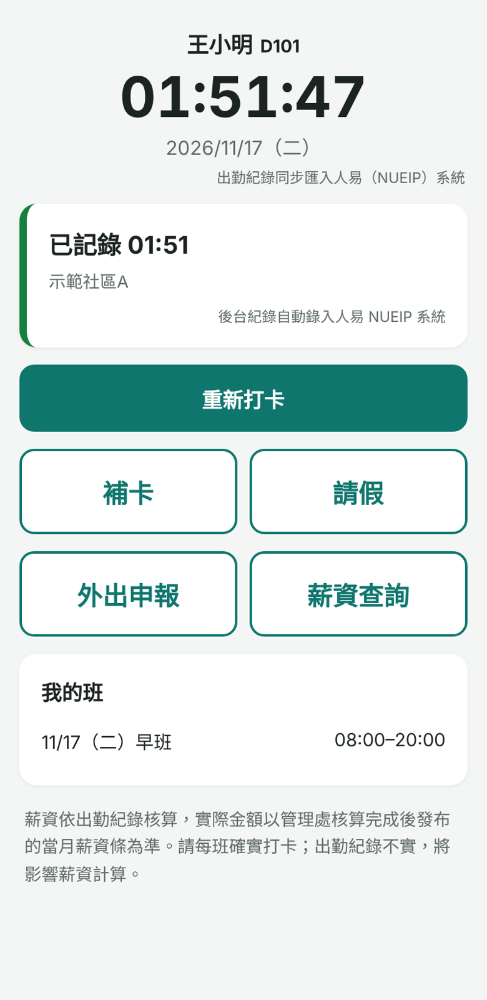
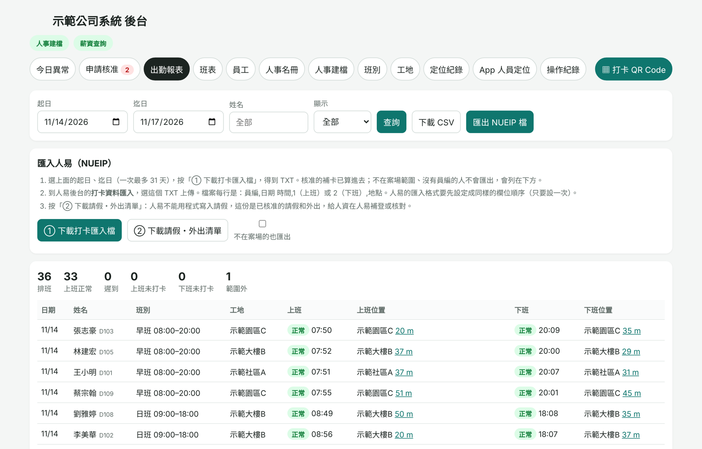
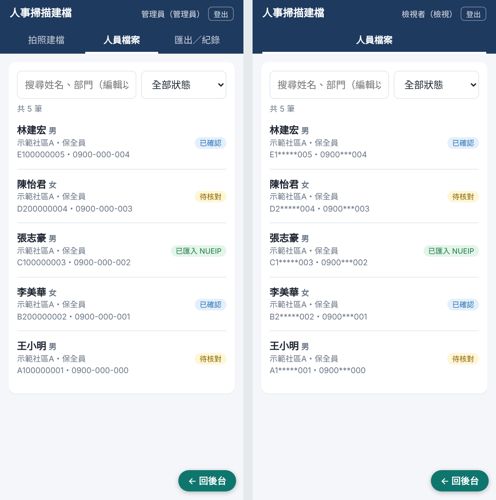
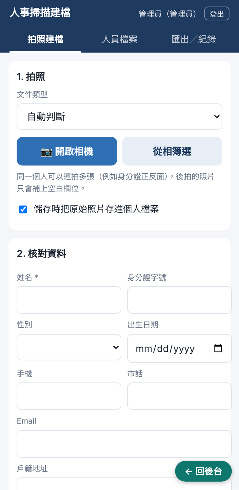

# 陳軒朋｜系統開發作品集

我在一家保全物業公司做行政和人資工作。日常很多事都靠人工重複處理：打卡資料要整理後手動匯入人事系統，新進人員的資料要一筆一筆抄寫。所以我自學程式，搭配 AI 協作開發，把這些流程做成系統。從需求訪談、資料庫設計、開發、部署到員工教學，都是我一個人完成。

下面的系統**目前都在公司實際使用**。為了保護公司與同仁的資料，這裡的截圖都是在測試環境用**虛構資料**拍的，原始碼放在私人倉庫。

---

## 一、出勤整合系統（打卡 × 補卡請假 × 考勤查核 × 薪資查詢）

員工分散在各個案場，以前用紙本或口頭回報出勤，很難確認是不是真的到班。現在員工用手機打卡，主管在後台就能看到異常。

### 系統架構

### 主要功能
- **定位打卡**：比對員工位置與案場距離，判斷正常、遲到或不在範圍內。時間一律以伺服器為準。
- **防代打卡**：每人預設最多綁定 2 台裝置。
- **補卡、請假、外出申報**：員工在手機上送出，主管在後台核准。核准紀錄會留下申請和核准時間（到秒）以及核准人，方便稽核。
- **今日異常**：只列出需要處理的出勤，包括跨夜班。
- **匯入人事系統**：出勤資料直接匯出成 NUEIP 的匯入格式，取代人工重打。
- **Android App 自動更新**：程式推上 GitHub 後，GitHub Actions 自動打包並簽章，員工的 App 會在背景更新。

| 後台：今日異常與待核准申請 | 員工端手機畫面 |
|---|---|
|  |  |

---

## 二、AI 人事掃描建檔系統

以前新進人員的身分證、到職單都要人工抄寫輸入，現在改成用手機拍照，由 AI 擷取欄位，人工只需要核對。

- **流程**：拍照 → AI 視覺模型擷取姓名、證號、生日、地址等欄位 → 沒把握的欄位標黃色提醒 → 人工核對後入庫。
- **自動分人**：一次拍多張、多個人的證件，系統會依證號和姓名自動分成多筆資料。
- **三級權限**：管理員、建檔人員、檢視者。檢視者看到的證號和電話會**自動遮蔽**。
- **操作紀錄**：每次查看、修改、刪除都會記錄是誰做的。

| 權限設計：同一份名單，管理員（左）與檢視者（右）看到的內容 | 拍照建檔畫面 |
|---|---|
|  |  |

---

## 三、其他內部工具

- **薪資查詢**：員工輸入姓名加身分證後 4 碼驗證後，可以查當月實領金額和備註，並下載 Word 薪資單。
- **倉庫庫存動態表**：把手寫盤點表數位化，用櫃位圖對照線上庫存，並產出可列印的櫃位標籤。
- **NUEIP 打卡比對工具**：比對打卡紀錄和班表，找出缺卡、遲到早退，自動產生補卡清單。

---

## 技術選擇

| 項目 | 選擇 | 原因 |
|---|---|---|
| 後端 | Cloudflare Workers（無伺服器） | 不用自己維護主機，費用低，部署快 |
| 資料庫 | Cloudflare D1（SQLite） | 跟 Worker 同平台，用 SQL 查詢報表方便 |
| 前端 | HTML／JavaScript | 員工用手機瀏覽器就能開，不用另外安裝 |
| App | Android（Java，WebView 外殼） | 支援背景定位與開機自動排程，畫面跟網頁共用 |
| CI/CD | GitHub Actions | 推上去就自動打包、簽章、發佈 |
| AI | Workers AI 視覺模型 | 處理拍歪、反光、格式不一的證件照 |

**資安與個資**：密碼和金鑰都放在 Cloudflare 與 GitHub 的 Secrets 裡，不寫在程式碼中。名冊只同步出勤需要的欄位。敏感欄位依權限遮蔽，主管查詢員工位置也會留下紀錄。

---

## 聯絡

如果想看實際操作，歡迎面試時現場示範。
